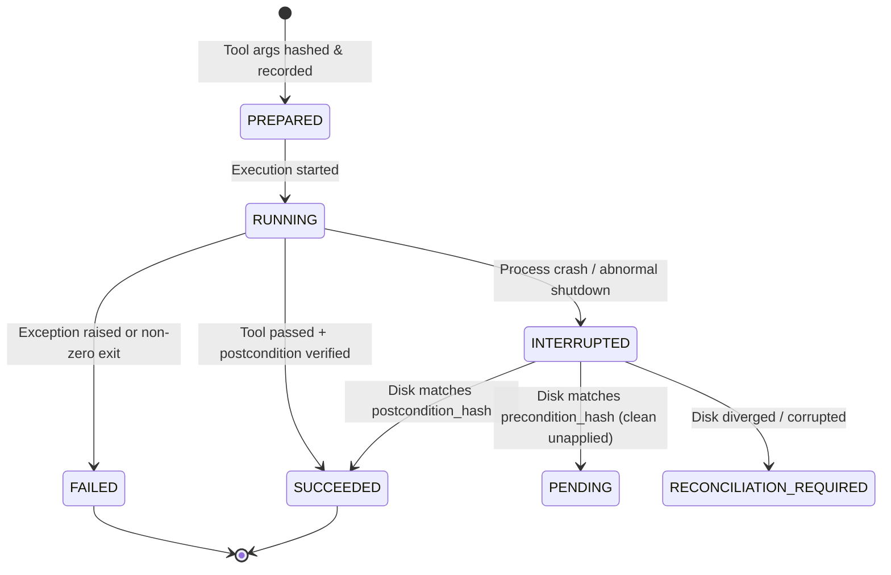

# Recovery, Idempotency, and Crash Consistency

This document defines the recovery, idempotency, and crash-consistency mechanisms implemented in the Autonomous Coding System.

---

## 1. The Challenge of Crash Consistency in Autonomous Agents

Autonomous software agents execute operations that mutate external state (file creation, code modification, configuration changes). A conventional checkpoint saved only at the completion of a multi-step task leaves the system vulnerable to:
1. **Mid-Flight Crashes:** If the agent process or host crashes while applying a file edit, the agent loses track of whether the modification was partially written, fully written, or untouched.
2. **Blind Resumption:** Resuming an interrupted run by restarting steps from scratch causes duplicate side effects (e.g. appending code twice, corrupting manifests).
3. **Ghost State:** Discrepancies between what the agent's database believes and the actual byte state of the disk.

To solve this, Phase 2 implements a **Durable Operation Journal** backed by SQLite Write-Ahead Logging (WAL) and SHA-256 state hashing.

---

## 2. Durable Operation Journal Schema

Every tool invocation is tracked as a distinct operation record in SQLite (`operations` table):

```sql
CREATE TABLE IF NOT EXISTS operations (
    operation_id TEXT PRIMARY KEY,
    run_id TEXT NOT NULL,
    step_id TEXT NOT NULL,
    idempotency_key TEXT UNIQUE NOT NULL,
    tool TEXT NOT NULL,
    input_hash TEXT NOT NULL,
    precondition_hash TEXT,
    postcondition_hash TEXT,
    state TEXT NOT NULL,
    execution_attempt INTEGER NOT NULL DEFAULT 1,
    inputs_json TEXT NOT NULL,
    result_json TEXT,
    error TEXT,
    recovery_status TEXT,
    started_at TEXT,
    completed_at TEXT,
    created_at TEXT NOT NULL,
    updated_at TEXT NOT NULL
);
```

### Operation States



---

## 3. Idempotency Key Computation

Before invoking any tool, the runner deterministically hashes its normalized inputs:

$$\text{input\_hash} = \text{SHA-256}(\text{JSON}(\text{tool\_args}))[:16]$$
$$\text{idempotency\_key} = \text{SHA-256}(\text{run\_id} \parallel \text{step\_id} \parallel \text{input\_hash})[:16]$$

When a step is evaluated:
1. The runner queries `get_operation_by_idempotency_key(idempotency_key)`.
2. If an operation exists with state `SUCCEEDED`:
   - The execution of the tool is skipped.
   - The cached `result` is populated into the plan step.
   - A timeline event is logged: `Step 'implement' skipped: operation already succeeded (idempotent replay)`.
   - **Zero redundant disk mutations occur.**

---

## 4. Precondition and Postcondition Content Hashing

For file-mutating operations (`workspace.plan`), the agent precomputes deterministic hashes:
- `precondition_hash`: The SHA-256 hash of the target file before the write, or `"ABSENT"` if the file does not yet exist.
- `postcondition_hash`: The SHA-256 hash of the expected target file content after applying the write.

Both hashes are stored in SQLite in the `PREPARED` state **before** the tool touches the filesystem.

---

## 5. Automatic Crash Reconciliation on Boot/Resume

When `AgentRun.execute()` or `resume_run()` is invoked:
1. `_reconcile_interrupted_operations()` scans SQLite for any operations in `run_id` that were left in `PREPARED` or `RUNNING` state.
2. For each interrupted operation:
   - Reads the current file from disk and calculates `current_hash = compute_file_hash(target)`.
   - **Case A (Disk == Postcondition):** The mutation succeeded just before the crash. The operation is reconciled to `SUCCEEDED` with `recovery_status="reconciled_from_postcondition"`. Execution continues safely.
   - **Case B (Disk == Precondition):** The crash happened before disk write. The operation is reset to `PENDING` with `recovery_status="unapplied_clean_precondition"`. The tool can be safely applied.
   - **Case C (Disk != Precondition and Disk != Postcondition):** The file was partially written, altered, or corrupted. The operation is marked `RECONCILIATION_REQUIRED`. The run halts immediately with `RunStatus.RECONCILIATION_REQUIRED` and demands operator intervention.

---

## 6. Concurrency Safety: Per-Run Mutex Locking

To prevent race conditions where multiple concurrent requests call `/api/v1/runs/{run_id}/resume`:
1. `_get_run_lock(run_id)` maintains a thread-safe mutex lock for each active run ID.
2. The first thread acquires the lock and begins execution.
3. Subsequent threads block on the lock. Once acquired, they inspect the fresh checkpoint.
4. If `checkpoint.status == RunStatus.COMPLETED`, the runner immediately returns the completed result without re-executing steps or modifying the workspace.
